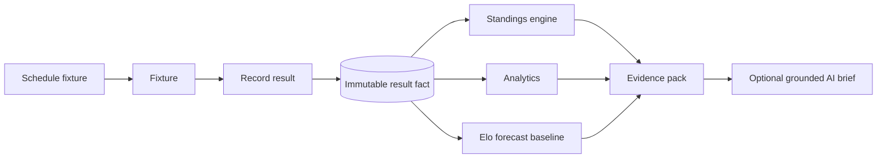
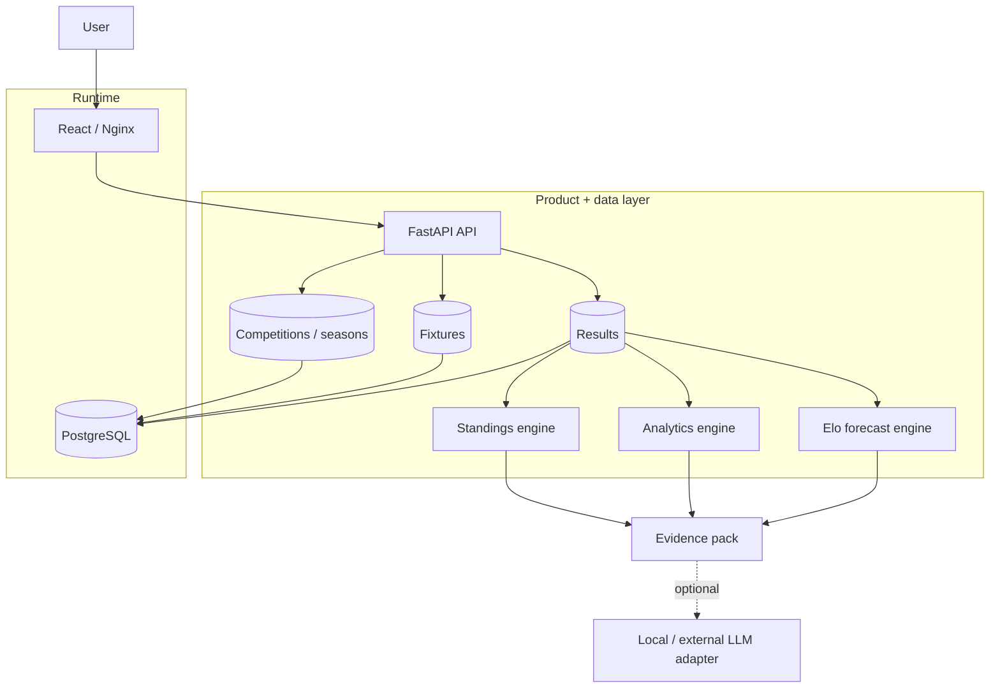
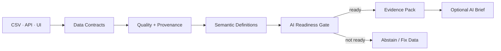
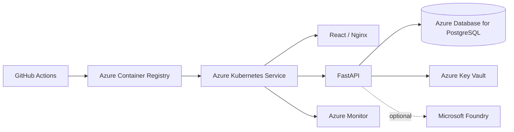

# StandingsOS

**Competition intelligence from match facts.**

[](https://github.com/cssaritama/standingsos/actions/workflows/ci.yml)
[](LICENSE)

StandingsOS is a product-oriented reference implementation for running a football competition without duplicating truth across spreadsheets, score records and league tables.

The core rule is deliberately strict:

> **Fixtures describe what should happen. Results record what happened. Standings, analytics and forecasts are derived from those facts. AI is allowed to explain evidence, never replace it.**

The project combines product design, relational data modeling, deterministic analytics, a transparent forecasting baseline, optional evidence-grounded AI, containerized delivery and a cloud-portable Kubernetes application layer.

---


## At a glance

**StandingsOS turns competition operations into trustworthy, AI-ready decision infrastructure.**

| Layer | What the repository proves |
| --- | --- |
| **Product** | competitions, seasons, fixtures, results, standings, forecasts and CSV workflows |
| **AI-ready data** | contracts, quality rules, provenance, semantic definitions and readiness gating |
| **Intelligence** | deterministic standings/analytics + transparent Elo forecasting + bounded AI evidence |
| **Engineering** | FastAPI, React, PostgreSQL, tests, OpenAPI, Docker, Kubernetes and CI |
| **Cloud** | Azure-first deployment architecture with portable Kubernetes boundaries |
| **Governance** | implemented vs roadmap status, evidence boundaries, abstention and auditable calculations |

**Evidence links:** [Architecture](docs/architecture.md) · [AI-ready data](docs/ai-ready-data.md) · [Context engineering](docs/context-engineering.md) · [Azure architecture](docs/azure-architecture.md) · [Specs](specs/README.md)

> **Visual proof:** the repository now includes a capture checklist in [`docs/visual-evidence.md`](docs/visual-evidence.md). Screenshots and GIFs should be added only from a real running build—never mocked.

---


## The problem

Small and mid-sized competitions often begin with a spreadsheet. Fixtures are maintained in one place, results in another, and the table is recalculated manually or copied into a third system. That creates a predictable failure mode: **multiple representations of the same truth drift apart**.

StandingsOS explores a cleaner product model:



No standings table is persisted. The table is rebuilt from recorded results whenever it is requested.

---

## Product experience

The demo product supports a complete competition loop:

- create competitions and seasons through the API;
- enroll teams into a season;
- schedule fixtures separately from results;
- record immutable result facts and explicitly remove/re-record a correction;
- derive standings from the current result set;
- inspect completion, scoring and outcome analytics;
- view transparent Elo-based probabilities for upcoming fixtures;
- import/export season data as CSV;
- optionally generate an LLM narrative from a bounded evidence pack;
- run the same application locally, in Docker, in kind, or behind a managed PostgreSQL database on Kubernetes.

Docker Compose seeds a fictional `Global City League · 2026/27` dataset so the interface is useful immediately after startup.

---

## Why this project is different

This repository is intentionally not a collection of technology badges. Each layer exists to support a product or engineering decision.

| Capability | What is implemented | Why it exists |
| --- | --- | --- |
| Product | competitions, seasons, teams, fixtures, results | model a real competition workflow rather than a CRUD demo |
| Data | normalized PostgreSQL model, CSV portability, source metadata | preserve lineage and avoid spreadsheet lock-in |
| Decision intelligence | derived standings + season analytics | convert operational facts into inspectable decisions |
| Predictive analytics | transparent Elo baseline | demonstrate probabilistic reasoning without black-box claims |
| AI | optional Ollama brief from a bounded evidence pack | let an LLM explain evidence without letting it invent calculations |
| Cloud | Docker + Kubernetes + Azure-first architecture + AWS/GCP portability references | keep the application layer portable across container platforms |
| Quality | unit, API, PostgreSQL, contract and container checks | keep the repository reproducible and reviewable |

---

## Architecture



The code keeps deterministic work outside the LLM. If AI is disabled, the full product still works.

See [Executive Architecture Brief](docs/executive-architecture-brief.md), [Architecture](docs/architecture.md), [Data & Intelligence](docs/data-intelligence.md), [AI Design](docs/ai-design.md), [Azure Architecture](docs/azure-architecture.md), [Cloud Strategy](docs/cloud-strategy.md) and [Cloud Portability](docs/multicloud.md).

---

## Tech stack

**Application**

- Python 3.12
- FastAPI
- SQLAlchemy 2
- Pydantic 2
- React 19
- Vite
- Nginx

**Data & intelligence**

- PostgreSQL for deployed environments
- SQLite for lightweight local backend development
- pure-Python standings engine
- season-level descriptive analytics
- Elo-based forecast baseline
- CSV import/export
- optional Ollama-compatible AI brief

**Delivery**

- Docker / Docker Compose
- Kubernetes + Kustomize
- kind local cluster workflow
- Azure-first Kubernetes deployment architecture
- AWS / GCP portability reference overlays
- GitHub Actions
- Dependabot

---


## AI-ready data foundation

StandingsOS v2.2 adds an explicit, deterministic boundary between operational data and AI.



The product exposes:

- versioned data contracts;
- deterministic quality/readiness scoring;
- provenance coverage;
- semantic metric definitions;
- an AI readiness API and UI panel;
- an AI gate that refuses to generate a brief when evidence is not fit for use.

The readiness score is calculated by code—not by an LLM—and its dimensions and policy are inspectable in `data/`.

This is intentionally a product-level readiness framework, not a claim to replace enterprise data-quality platforms.

See [AI-ready data](data/README.md), [Spec 002](specs/002-ai-ready-data-foundation.md) and [Context Engineering](docs/context-engineering.md).

---

## Azure-first cloud direction

StandingsOS now uses **Microsoft Azure as its primary cloud architecture target** while keeping the application boundary portable.



The repository is explicit about status:

| Environment | Status |
| --- | --- |
| Docker Compose | Implemented |
| kind / local Kubernetes | Implemented |
| Azure AKS architecture | Deployment-ready |
| AWS EKS mapping | Reference architecture |
| Google GKE mapping | Reference architecture |

This distinction matters: **architecture is not deployment evidence**. The Azure runbook defines what must be validated before the repository claims a live Azure deployment.

See [`docs/azure-architecture.md`](docs/azure-architecture.md) and [`infra/azure/README.md`](infra/azure/README.md).

---

## Quick start

### Docker Compose

```bash
git clone https://github.com/cssaritama/StandingsOS.git
cd StandingsOS
cp .env.example .env
docker compose up --build -d --wait
```

Open:

- Product UI: <http://localhost:8080>
- API docs: <http://localhost:8000/docs>
- Health: <http://localhost:8000/health>
- Readiness: <http://localhost:8000/ready>

The seeded demo gives you completed and upcoming fixtures immediately.

Stop the stack:

```bash
docker compose down
```

Remove the demo database volume as well:

```bash
docker compose down -v
```

---

## Optional AI brief

AI is disabled by default. The product does not depend on an LLM.

To use a local Ollama-compatible endpoint:

```bash
# example model installation outside this repository
ollama pull llama3.2:3b

# .env
AI_PROVIDER=ollama
AI_MODEL=llama3.2:3b
OLLAMA_BASE_URL=http://host.docker.internal:11434

docker compose up --build -d --wait
```

The model receives only a bounded evidence payload containing the selected season, deterministic analytics, top standings rows and forecast probabilities. It is explicitly instructed not to invent external facts or recalculate standings.

This separation is intentional: **code calculates; the model communicates.**

---

## Data portability

StandingsOS treats CSV as a bridge from existing spreadsheet workflows rather than a legacy format to hide.

Sample file: [`data/sample-season.csv`](data/sample-season.csv)

Required columns:

```text
scheduled_at,home_team,away_team
```

Optional result columns:

```text
home_goals,away_goals,result_source
```

The UI can import a season CSV and export the current season in the same portable shape.

---

## API surface

Primary endpoints:

```text
GET    /api/v1/competitions
POST   /api/v1/competitions
GET    /api/v1/competitions/{id}/seasons
POST   /api/v1/competitions/{id}/seasons
GET    /api/v1/seasons/{id}/teams
POST   /api/v1/seasons/{id}/teams
GET    /api/v1/seasons/{id}/fixtures
POST   /api/v1/seasons/{id}/fixtures
POST   /api/v1/fixtures/{id}/result
DELETE /api/v1/fixtures/{id}/result
GET    /api/v1/seasons/{id}/standings
GET    /api/v1/seasons/{id}/analytics
GET    /api/v1/seasons/{id}/forecasts
GET    /api/v1/seasons/{id}/ai-brief
GET    /api/v1/seasons/{id}/export.csv
POST   /api/v1/seasons/{id}/import.csv
```

The committed [`openapi.yaml`](openapi.yaml) is checked in CI so API documentation cannot silently drift away from the implementation.

---

## Cloud portability

The application layer is intentionally Kubernetes-portable.

```text
infra/kubernetes/base/             shared application manifests
infra/kubernetes/overlays/local/   kind + in-cluster PostgreSQL demo
infra/kubernetes/overlays/aws/     EKS-oriented application overlay
infra/kubernetes/overlays/gcp/     GKE-oriented application overlay
infra/kubernetes/overlays/azure/   AKS-oriented application overlay
```

The three cloud overlays do **not** claim this repository is continuously deployed to three clouds. They demonstrate that the application contract is provider-neutral while production PostgreSQL, IAM, networking, TLS, DNS and registry policy remain environment responsibilities.

A production mapping is documented in [docs/multicloud.md](docs/multicloud.md).

---

## Local Kubernetes

Requirements: Docker, `kind`, `kubectl`.

```bash
./scripts/kind-deploy.sh
kubectl -n standingsos port-forward service/frontend 8080:80
```

Open <http://localhost:8080>.

---

## Quality gates

```bash
make backend-test
make frontend-check
```

CI validates:

1. backend lint and unit/API tests;
2. PostgreSQL integration behavior;
3. committed OpenAPI contract;
4. frontend lint and production build;
5. Docker Compose syntax;
6. backend and frontend container builds.

---

## Engineering principles

1. **One source of truth.** Results are facts; standings are derived.
2. **Separate operational state from analytical state.** Fixtures can exist before a result does.
3. **Keep deterministic logic deterministic.** Standings, analytics and probabilities live in code.
4. **Bound AI with evidence.** The LLM receives a controlled payload and cannot become the system of record.
5. **Prefer portable interfaces over cloud lock-in.** Containers, HTTP, PostgreSQL and Kubernetes form the application contract.
6. **State what is real.** Reference architectures are labelled as references; unverified production claims are avoided.

---

## Implemented vs roadmap

| Area | Implemented now | Next logical step |
| --- | --- | --- |
| Product | competitions, seasons, fixtures, results | roles, ownership and multi-user collaboration |
| Data | PostgreSQL + CSV + lineage field | warehouse/event export and richer data quality checks |
| Analytics | standings, descriptive metrics, Elo baseline | calibrated model evaluation and historical backtesting |
| AI | evidence-grounded optional narrative | model/provider abstraction + evaluation dataset |
| Cloud | Docker, kind, Kustomize cloud overlays | real Terraform environments and cloud CI/CD |
| Operations | health/readiness + CI | telemetry, SLOs and incident workflows |

The roadmap deliberately avoids pretending that future work is already implemented.

---

## Repository map

```text
backend/                  FastAPI, persistence, domain logic, analytics, AI adapter
frontend/                 React product interface
infra/kubernetes/         portable Kubernetes base and environment overlays
data/                     example portable datasets
docs/                     product, architecture, data, AI and cloud decisions
scripts/                  OpenAPI export, smoke test and kind deployment
.github/                  CI, dependency updates and contribution workflow
```

---

## Documentation

- [Product vision](docs/product-vision.md)
- [Architecture](docs/architecture.md)
- [Data & intelligence](docs/data-intelligence.md)
- [AI design and evidence policy](docs/ai-design.md)
- [Multicloud architecture](docs/multicloud.md)
- [Product and engineering decisions](docs/engineering-decisions.md)
- [Demo guide](docs/demo-guide.md)
- [Roadmap](docs/roadmap.md)
- [Portfolio evidence map](docs/portfolio-evidence.md)
- [Visual evidence checklist](docs/visual-evidence.md)
- [Azure validation evidence](docs/azure-validation.md)

---

## Status

**Portfolio product release: `v2.2.1`**

This is a production-minded reference implementation and portfolio project. It is not represented as a currently operated commercial SaaS or as a validated forecasting product.

## License

MIT — see [LICENSE](LICENSE).


## Engineering operating model

The repository also documents [Specification-driven Development](specs/README.md), [Context Engineering](docs/context-engineering.md) and [DevOps/DataOps/MLOps/LLMOps/FinOps boundaries](docs/operating-disciplines.md).
