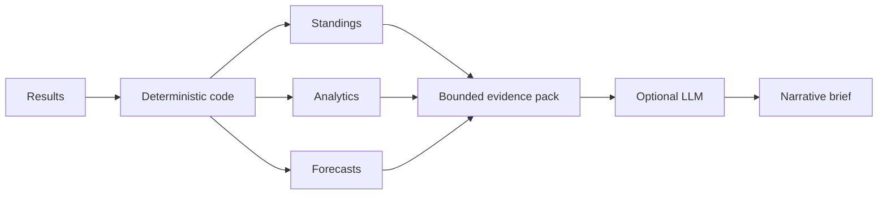

# AI design and evidence policy

## Principle

StandingsOS uses AI only where language is useful. It does not delegate deterministic calculations to a language model.

## Evidence pack

The AI receives:

- season identity;
- deterministic season analytics;
- top standings rows;
- upcoming forecast probabilities;
- an explicit policy describing the model's role.

It does not receive arbitrary database access.

## Prompt policy

The prompt requires the model to:

- use only the supplied evidence;
- avoid external news, injuries, transfers or invented statistics;
- avoid recalculating standings;
- state uncertainty when probabilities are close.

## Provider strategy

Release 2.0 implements an Ollama-compatible provider because it can be demonstrated locally without embedding a cloud-specific LLM dependency into the product.

`AI_PROVIDER=disabled` remains the default. The core product works with no model present.

## Evaluation roadmap

Before an AI brief should be treated as a production feature, add:

1. a labelled briefing evaluation set;
2. evidence-grounding checks;
3. hallucination and omission criteria;
4. prompt/model version capture;
5. latency and cost telemetry;
6. human review feedback.
