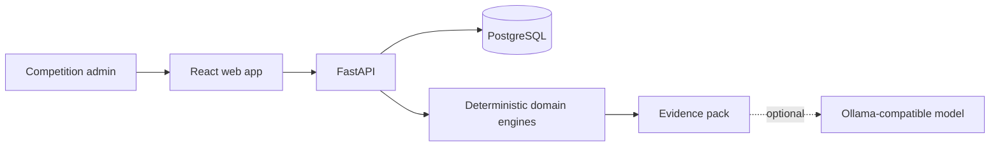
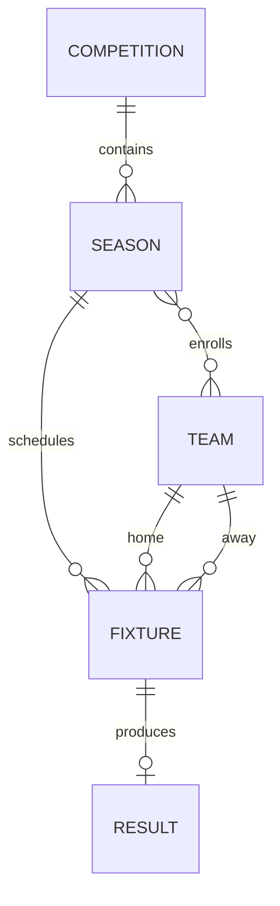

# Architecture

## System context

## Domain model

A fixture may exist without a result. A result cannot exist without a fixture. One fixture has at most one active result fact.

## Read path

Standings, analytics and forecasts are generated on read from the season's recorded results. This deliberately avoids a persisted table that could disagree with the source facts.

## Write path

A recorded result is not edited in place. A correction removes the current result and records the replacement. This keeps mutation explicit and preserves the mental model that results are facts rather than counters inside a standings row.

## AI boundary

The AI endpoint receives only a precomputed evidence payload. It does not connect directly to the database and it does not calculate standings or probabilities.

## Runtime boundary

The application requires only:

- an HTTP-capable container runtime;
- PostgreSQL-compatible persistence;
- environment-variable configuration.

That boundary is what makes the application portable across local Docker, kind and managed Kubernetes platforms.

## AI-ready boundary (v2.2)

Before the optional AI layer runs, season evidence passes through a deterministic readiness policy. Data contracts, provenance, semantic definitions and quality rules are versioned separately from the model prompt. This keeps the AI boundary inspectable and allows the system to abstain when evidence is not fit for use.
