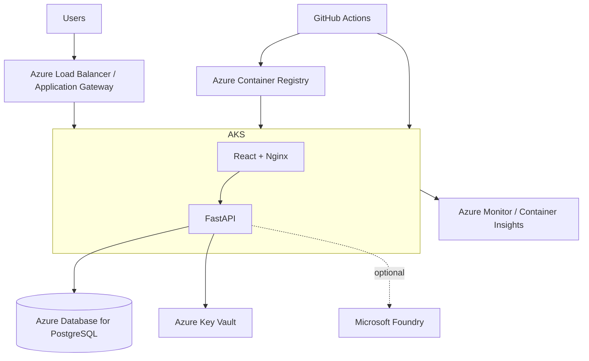

# Azure-first reference architecture

## Purpose

StandingsOS uses Microsoft Azure as its **primary cloud architecture target** while keeping the application contract portable across Kubernetes-based environments.

This repository does **not** claim a continuously running Azure production environment. It provides a deployment-ready architecture and operator runbook that can be validated in an Azure subscription without changing the product code.

## Target production architecture

## Service mapping

| Concern | Azure service | Why |
| --- | --- | --- |
| Containers | Azure Container Registry | private image lifecycle close to AKS |
| Orchestration | Azure Kubernetes Service | managed Kubernetes while preserving the portable app contract |
| Database | Azure Database for PostgreSQL | managed relational persistence without embedding database lifecycle in the app cluster |
| Secrets | Azure Key Vault | separate secret lifecycle from application manifests |
| Monitoring | Azure Monitor / Container Insights | platform logs, cluster visibility and operational diagnostics |
| AI extension | Microsoft Foundry | optional enterprise model / agent integration path for evidence-grounded brief generation |
| CI/CD | GitHub Actions | repository-native validation and deployment automation |

## Portability boundary

StandingsOS deliberately separates:

### Portable layer

- OCI images;
- FastAPI and React services;
- PostgreSQL connection contract;
- Kubernetes Deployments and Services;
- health/readiness probes;
- environment-based configuration;
- OpenAPI contract.

### Azure-native layer

- ACR;
- AKS identity and networking;
- Azure Database for PostgreSQL;
- Key Vault;
- Azure Monitor;
- Microsoft Foundry, when enabled.

This keeps the product portable without reducing Azure to the lowest common denominator.

## Deployment status language

Use these terms precisely:

- **Implemented** — exists and is tested in the repository.
- **Deployment-ready** — configuration/runbook exists but requires a live subscription to validate.
- **Reference architecture** — architectural mapping only.

Current status:

| Capability | Status |
| --- | --- |
| Local Docker Compose | Implemented |
| Local kind / Kubernetes | Implemented |
| Azure AKS application overlay | Deployment-ready |
| Azure managed PostgreSQL integration contract | Deployment-ready |
| Azure Key Vault integration path | Reference architecture |
| Azure Monitor integration path | Reference architecture |
| Microsoft Foundry AI integration | Reference architecture |
| AWS / GCP overlays | Reference architecture |

## Why Azure for this project

StandingsOS is a product and operations-oriented application. Azure gives the project a useful second-cloud identity in the portfolio while PennantIQ remains GCP-oriented. This creates a more credible multicloud story than claiming equal depth in every provider from one repository.
